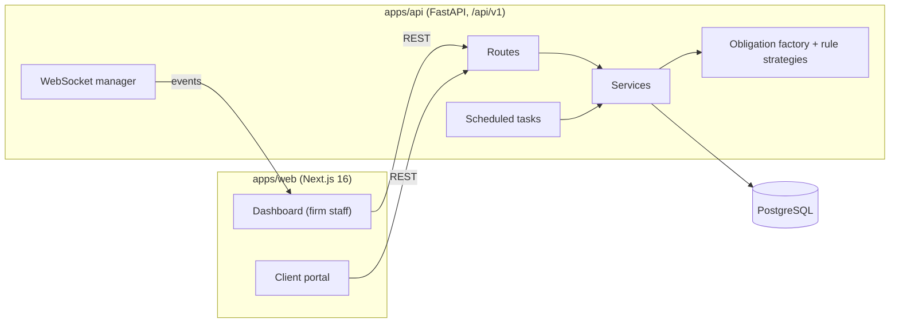

# ConsultContábil — SaaS for Accounting Firms

Management platform for Brazilian accounting firms: clients and their tax obligations, licenses and certificates with expiry alerts, fees, documents and reports, plus a client portal.

**Stack:** Next.js 16 (App Router) · TypeScript · HeroUI · React Hook Form + Zod · FastAPI · SQLAlchemy 2 (async) · PostgreSQL · Alembic · Pydantic v2 · WebSockets · ReportLab · Docker · pnpm workspaces

---

## Modules

| Module | What it covers | API |
|---|---|---|
| Clients | companies, CNAE activities, municipal registrations | `clients`, `cnaes`, `municipal_registrations` |
| Tax obligations | monthly obligation matrix per client, status tracking | `obligations` |
| Licenses & certificates | expiry dates, scheduled expiration checks, alerts | `licenses` + `tasks/license_expiration.py` |
| Finance | fees (honorários) and receipts | `finance` |
| Documents | client document storage | `documents` |
| Reports | PDF reports generated server-side (ReportLab) | `reports` |
| Notifications | real-time events to the dashboard | `websocket` + `app/websockets/` |
| Users & access | JWT auth, role-based access (firm admin and client portal) | `auth`, `users`, `admin` |

## Architecture



- **Contracts first:** each module has an API contract in `docs/contracts/` (auth, clients, obligations, licenses, reports, notifications, websocket) written before the implementation.
- **Patterns:** `app/patterns/factories/obligation_factory.py` builds each client's obligations from rule strategies per company type (`mei_rule`, `commerce_rule`, `industry_rule`, `service_rule` in `app/patterns/strategies/`). New tax regimes plug in as a new strategy instead of another `if/else`.
- **Shared types:** `packages/types` keeps the front end in sync with the API schemas.

## Project structure

```
apps/
  web/   Next.js App Router · (auth) · (dashboard) · portal · src/components · hooks · lib
  api/   FastAPI · api/v1/routes · services · patterns · websockets · tasks · alembic · tests (unit + integration)
packages/types   shared TypeScript types
docs/            PRD, API contracts, development guide, milestone notes
infra/           Docker Compose (dev), Nginx, init scripts
```

## Running locally

Requirements: Node 18.17+, pnpm 8+, Python 3.11+, Docker.

```bash
git clone https://github.com/ghitflux/consultcontabil.git && cd consultcontabil
pnpm install
cp .env.example .env
docker compose -f infra/docker-compose.dev.yml up      # PostgreSQL + API + web + Nginx

# or run each side yourself
pnpm dev:api        # FastAPI with reload (uvicorn)
pnpm dev:web        # Next.js
```

## Tests

```bash
cd apps/api
pytest                      # unit (models, repositories, security) + integration (auth, obligations, reports)
pytest --cov=app
```

## Status and next steps

Clients, obligations, licenses, finance, reports and auth are implemented; milestone notes live in `docs/marcos/`. Next:

- CI pipeline on GitHub Actions (lint, type-check, tests);
- e-mail/WhatsApp delivery for license and obligation alerts;
- audit log screen and wider front-end test coverage.

## How it was built

Spec first (PRD and API contracts), small diffs, human review before anything sensitive. AI coding assistants help with scaffolding and tests; every change is reviewed before merge. All CNPJs and names in seeds and tests are fictitious.

---

Hélcio Venâncio · [github.com/ghitflux](https://github.com/ghitflux)
